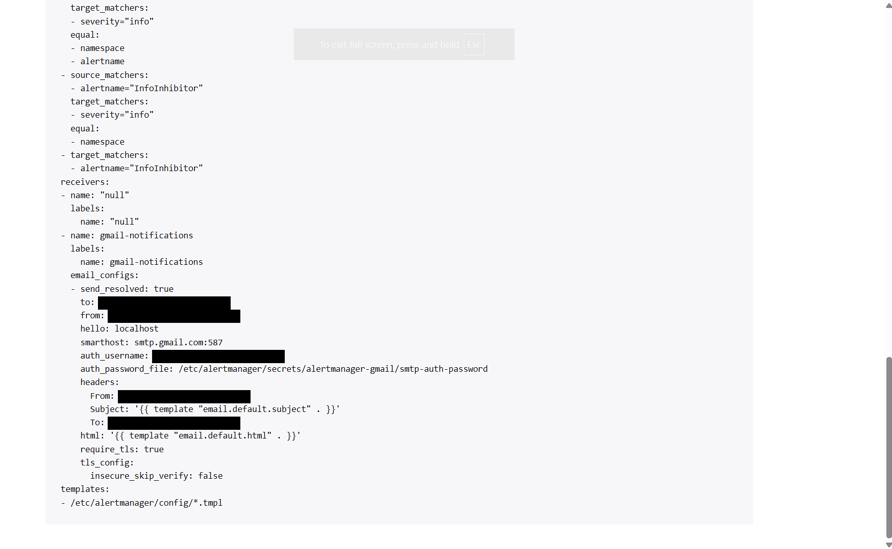
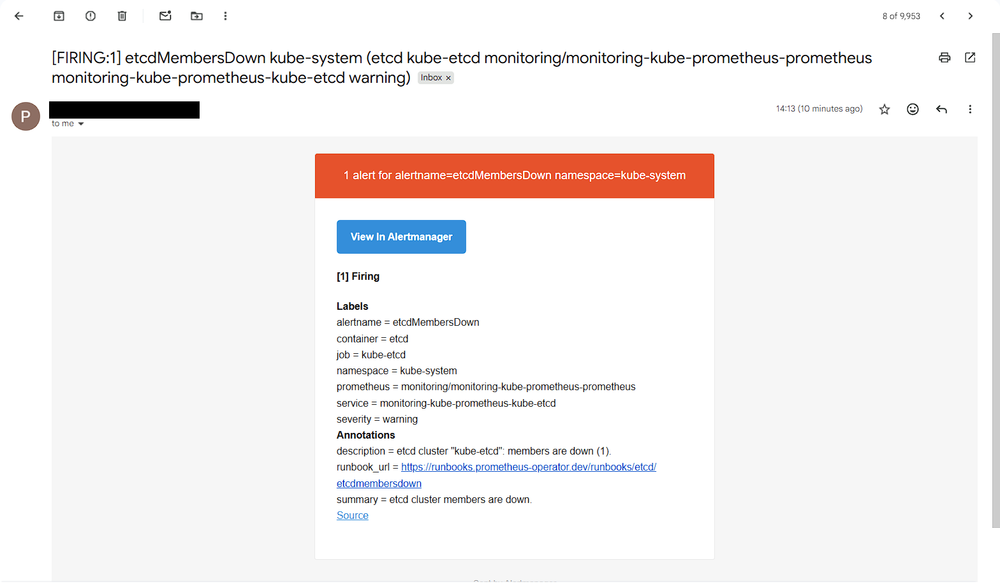

# GitOps-Based Kubernetes Deployment with Argo CD, Helm & Monitoring

A hands-on DevOps project demonstrating GitOps-based Kubernetes deployments using Argo CD, Helm chart management, and Kubernetes monitoring using Prometheus, Grafana, and Alertmanager with Gmail email notifications.

The project uses GitHub as the source of truth for Kubernetes manifests, Helm charts, and Prometheus alert rules. Argo CD continuously monitors the repository and reconciles Kubernetes resources with the desired configuration stored in Git.

---

## 1. Project Overview

This project demonstrates three major areas of Kubernetes DevOps:

1. **Kubernetes Deployment:** Deploying Nginx using Kubernetes Deployment and Service manifests.
2. **GitOps with Argo CD and Helm:** Managing Kubernetes resources through GitHub and automating synchronization using Argo CD.
3. **Monitoring and Alerting:** Monitoring cluster resources using Prometheus and Grafana, creating custom alert rules, and sending email notifications through Alertmanager and Gmail SMTP.

### Project Environment

| Component | Configuration |
|---|---|
| Operating System | Windows 11 |
| Container Runtime | Docker Desktop |
| Kubernetes | Minikube |
| Kubernetes Version | v1.35.1 |
| Minikube Version | v1.38.1 |
| Package Manager | Helm |
| GitOps Tool | Argo CD v3.6.2 |
| Monitoring Stack | kube-prometheus-stack |
| Metrics Collection | Prometheus |
| Visualization | Grafana |
| Alert Management | Alertmanager |
| Notification | Gmail SMTP |
| Version Control | Git and GitHub |
| Git Branch | main |

---

## 2. Architecture

### High-level architecture

```text
                    Developer
                        |
                        |
                     Git Push
                        |
                        v
                 GitHub Repository
                        |
                        v
                     Argo CD
                        |
                Monitors Git Repository
                        |
          +-------------+-------------+
          |             |             |
          v             v             v
       Nginx         Nginx Helm    Monitoring
       GitOps        Application     Alerts
          |             |             |
          v             v             v
     Kubernetes    Kubernetes    PrometheusRule
     Deployment    Deployment      Resource
          |             |
          v             v
      Nginx Pods    Nginx Pods
          |             |
          v             v
       NodePort       NodePort


               Kubernetes Cluster
                        |
                        v
                    Prometheus
                        |
             Collects Kubernetes Metrics
                        |
             +----------+----------+
             |                     |
             v                     v
          Grafana              Alert Evaluation
             |                     |
             v                     v
      Monitoring Dashboard     Alertmanager
                                    |
                              Alert Routing
                                    |
                                    v
                              Gmail SMTP
                                    |
                                    v
                              Email Inbox
```

### GitOps workflow

1. Developer makes changes to Kubernetes YAML files or Helm chart configuration.
2. Changes are committed and pushed to GitHub.
3. Argo CD monitors the configured Git repository and branch.
4. Argo CD detects changes in the repository.
5. Argo CD synchronizes the desired configuration with the Kubernetes cluster.
6. Kubernetes creates or updates the required resources.
7. Automated self-healing helps restore manually modified resources to their desired Git state.

**Important:** Argo CD performs continuous delivery (CD). This project does not currently contain a separate CI pipeline for building application images.

---

## 3. Repository Structure

```text
gitops-argocd-project/
│
├── helm/
│   └── nginx-chart/
│       ├── templates/
│       │   ├── _helpers.tpl
│       │   ├── deployment.yaml
│       │   └── service.yaml
│       │
│       ├── .helmignore
│       ├── Chart.yaml
│       └── values.yaml
│
├── k8s/
│   ├── deployment.yaml
│   └── service.yaml
│
├── monitoring/
│   └── alerts/
│       └── prometheus-rules.yaml
│
├── screenshots/
│   ├── 01-kubernetes-deployments.png
│   ├── 02-argocd-applications.png
│   ├── 03-argocd-application-details.png
│   ├── 04-grafana-kubernetes-dashboard.png
│   ├── 05-prometheus-alert-rules.png
│   ├── 06-prometheus-target-health.png
│   ├── 07-alertmanager-alerts.png
│   ├── 08-gmail-alert-notification.png
│   ├── 09-alertmanager-gmail-configuration.png
│   └── 10-gmail-resolved-notification.png
│
├── nginx-gitops-app.yaml
├── nginx-helm-app.yaml
├── monitoring-alerts-app.yaml
├── .gitignore
└── README.md
```


### Purpose of each directory

| File or Directory | Purpose |
|---|---|
| `k8s/` | Kubernetes Nginx Deployment and Service manifests |
| `helm/nginx-chart/` | Custom Helm chart for Nginx |
| `templates/` | Helm templates that generate Kubernetes resources |
| `Chart.yaml` | Helm chart metadata and application version |
| `values.yaml` | Configurable image, replicas, service and resource values |
| `monitoring/alerts/` | Custom Prometheus alert rules |
| `monitoring-alerts-app.yaml` | Argo CD Application for monitoring alert rules |
| `screenshots/` | Project implementation screenshots |
| `.gitignore` | Excludes local configuration and generated files |
| `README.md` | Project documentation |

---

## 4. Kubernetes Deployment

### Deployment configuration

Created a Kubernetes Deployment using:

- Image: `nginx:1.27`
- Replicas: 3
- Container port: 80
- Label: `app: nginx`

File: `k8s/deployment.yaml`

### Service configuration

Created a NodePort Service to expose Nginx outside the cluster.

| Configuration | Value |
|---|---|
| Service name | nginx-service |
| Type | NodePort |
| Service port | 80 |
| Target port | 80 |
| NodePort | 30080 |

File: `k8s/service.yaml`

### Deployment commands

```bash
kubectl apply -f k8s/
```

Verify resources:

```bash
kubectl get deployments
kubectl get pods
kubectl get services
```

Access the Nginx service:

```bash
minikube service nginx-service
```

The application is also accessible through the Minikube node IP and NodePort when the networking setup permits it.

---

## 5. Helm Chart Deployment

Created a custom Helm chart to deploy Nginx without maintaining separate static manifests for every configuration.

### Helm chart structure

```text
nginx-chart/
│
├── templates/
│   ├── _helpers.tpl
│   ├── deployment.yaml
│   └── service.yaml
│
├── Chart.yaml
└── values.yaml
```

### Chart.yaml

Contains:

- Chart name: `nginx-chart`
- Chart version: `0.1.0`
- Application version: `1.27`
- Chart type: `application`

### values.yaml

The chart uses configurable values:

| Setting | Value |
|---|---|
| Replica count | 3 |
| Image repository | nginx |
| Image tag | 1.27 |
| Pull policy | IfNotPresent |
| Service type | NodePort |
| Service port | 80 |
| NodePort | 30081 |
| CPU request | 100m |
| Memory request | 64Mi |
| CPU limit | 250m |
| Memory limit | 128Mi |

### Helm template concepts used

- `.Values` for accessing values from `values.yaml`.
- `toYaml` for rendering resource configuration.
- `nindent` for correct YAML indentation.
- Helm templates for generating Deployment and Service resources.

### Helm commands

Validate chart:

```bash
helm lint ./helm/nginx-chart
```

Preview generated Kubernetes YAML:

```bash
helm template nginx-helm ./helm/nginx-chart
```


**Alternative deployment method (Manual Helm installation):**

> Use this method only if you want to deploy the chart directly using Helm.
> If Argo CD is already managing the `nginx-helm` application, do not run this command.
> Avoid managing the same Kubernetes resources through both Helm CLI and Argo CD.

```bash
helm install nginx-helm ./helm/nginx-chart
```

Check Helm releases:

```bash
helm list -A
```

Check deployed resources:

```bash
kubectl get deployments
kubectl get pods
kubectl get services
```

The Helm-managed Deployment is named `nginx-helm-deployment`, and its Service is `nginx-helm-service`.

The NodePort configured for this Service is `30081`.

---

## 6. Argo CD GitOps Implementation

Installed Argo CD inside the Kubernetes cluster.

### Installation

Create namespace:

```bash
kubectl create namespace argocd
```

Install Argo CD:

```bash
kubectl apply -n argocd -f https://raw.githubusercontent.com/argoproj/argo-cd/stable/manifests/install.yaml
```

Verify installation:

```bash
kubectl get pods -n argocd
```

### Access Argo CD UI

```bash
kubectl port-forward svc/argocd-server 8080:443 -n argocd
```

Open:

```text
https://localhost:8080
```

The initial administrator password can be retrieved using:

```bash
kubectl get secret argocd-initial-admin-secret \
  -n argocd \
  -o jsonpath="{.data.password}" | base64 -d
```

### Argo CD applications created

Three separate applications were configured.

| Application | Git Repository Path | Destination Namespace |
|---|---|---|
| nginx-gitops | `k8s` | default |
| nginx-helm | `helm/nginx-chart` | default |
| monitoring-alerts | `monitoring/alerts` | monitoring |

All three applications were verified as:

- Sync Status: Synced
- Health Status: Healthy

### Automated synchronization

Configured automated synchronization for the applications.

| Setting | Purpose |
|---|---|
| Automated Sync | Automatically applies changes from Git |
| Prune | Removes resources no longer defined in Git |
| Self Heal | Reconciles manually changed live resources with Git |

### Understanding Self-Healing

Self-healing is one of the important GitOps features demonstrated in this project.

Example:

1. A PrometheusRule resource is defined in Git with severity `warning`.
2. The resource is deployed to Kubernetes through Argo CD.
3. The live Kubernetes resource is manually changed to severity `critical`.
4. Argo CD detects the difference.
5. Argo CD restores the desired value from Git.

This demonstrates how GitOps helps prevent configuration drift.

---

## 7. Kubernetes Monitoring with Prometheus and Grafana

Installed the Prometheus Community `kube-prometheus-stack` using Helm.

This stack provides Kubernetes monitoring components, including Prometheus, Grafana, Alertmanager, Prometheus Operator, kube-state-metrics, and node-exporter.

### Installation

Add Helm repository:

```bash
helm repo add prometheus-community https://prometheus-community.github.io/helm-charts
```

Update repositories:

```bash
helm repo update
```

Create monitoring namespace:

```bash
kubectl create namespace monitoring
```

Install monitoring stack:

```bash
helm install monitoring prometheus-community/kube-prometheus-stack \
  --namespace monitoring
```

Verify monitoring components:

```bash
kubectl get pods -n monitoring
```

### Prometheus

Prometheus collects and stores time-series metrics from configured targets.

In this project, it is used to monitor:

- Kubernetes nodes.
- Pod status.
- Container metrics.
- Resource utilization.
- Monitoring component health.

Access Prometheus:

```bash
kubectl port-forward -n monitoring \
  svc/monitoring-kube-prometheus-prometheus 9090:9090
```

URL:

```text
http://localhost:9090
```

### Useful PromQL queries

Check target availability:

```promql
up
```

Total pods:

```promql
sum(kube_pod_info)
```

Pods by phase:

```promql
sum by (phase) (kube_pod_status_phase == 1)
```

Node CPU utilization:

```promql
100 * (1 - avg by (instance) (
  rate(node_cpu_seconds_total{mode="idle"}[5m])
))
```

Node memory utilization:

```promql
100 * (
  1 - node_memory_MemAvailable_bytes /
  node_memory_MemTotal_bytes
)
```

Container restart count:

```promql
sum(kube_pod_container_status_restarts_total)
```

---

## 8. Grafana Dashboard

Grafana was configured with Prometheus as a data source.

Prometheus data source URL:

```text
http://monitoring-kube-prometheus-prometheus.monitoring:9090/
```

Alertmanager data source URL:

```text
http://monitoring-kube-prometheus-alertmanager.monitoring:9093/
```

### Access Grafana

```bash
kubectl port-forward -n monitoring svc/monitoring-grafana 3000:80
```

URL:

```text
http://localhost:3000
```

Retrieve the Grafana administrator password:

```bash
kubectl get secret monitoring-grafana \
  -n monitoring \
  -o jsonpath="{.data.admin-password}" | base64 -d
```

### Custom Kubernetes Monitoring Dashboard

Created a dashboard named `Kubernetes Monitoring` with nine panels.

| No. | Panel | What it monitors |
|---|---|---|
| 1 | Running Pods | Number of running pods |
| 2 | Node CPU Utilization | Node CPU usage percentage |
| 3 | Node Memory Utilization | Node memory usage percentage |
| 4 | Pod Status by Phase | Running, Pending, Failed and other pod phases |
| 5 | Node Health Status | Kubernetes node readiness |
| 6 | Failed Pods | Number of failed pods |
| 7 | Pending Pods | Number of pending pods |
| 8 | Total Pods | Total pod count |
| 9 | Container Restarts | Cumulative container restart count |

The dashboard provides a centralized view of Kubernetes cluster health and resource utilization.

The custom dashboard was created and captured as project evidence. Its JSON provisioning is not currently maintained in the Git repository.

---

## 9. Prometheus Alert Rules

Created custom Kubernetes alert rules using the `PrometheusRule` custom resource.

File:

```text
monitoring/alerts/prometheus-rules.yaml
```

### PrometheusRule configuration

| Configuration | Value |
|---|---|
| API Version | monitoring.coreos.com/v1 |
| Resource Kind | PrometheusRule |
| Resource Name | kubernetes-alert-rules |
| Namespace | monitoring |
| Release Label | monitoring |

The `release: monitoring` label is important because the installed Prometheus configuration uses this label to select PrometheusRule resources.

### Custom alerts implemented

**1. PodCrashLooping**

Detects containers entering the `CrashLoopBackOff` state.

- Evaluation duration: 2 minutes
- Severity: critical

**2. PodPending**

Detects pods that remain in the Pending phase.

- Evaluation duration: 5 minutes
- Severity: warning

**3. PodNotReady**

Detects pods that are not Ready, excluding successfully completed pods.

- Evaluation duration: 5 minutes
- Severity: warning

**4. KubernetesNodeNotReady**

Detects Kubernetes nodes that are not Ready.

- Evaluation duration: 5 minutes
- Severity: critical

### Apply alert rules

```bash
kubectl apply -f monitoring/alerts/prometheus-rules.yaml
```

Validate before applying:

```bash
kubectl apply --dry-run=server -f monitoring/alerts/prometheus-rules.yaml
```

Verify the resource:

```bash
kubectl get prometheusrules -n monitoring
```

View the resource:

```bash
kubectl describe prometheusrule kubernetes-alert-rules -n monitoring
```

### Alert lifecycle

1. Prometheus evaluates configured alert expressions.
2. When an expression remains true for its configured `for` duration, the alert becomes Firing.
3. Prometheus sends firing alerts to Alertmanager.
4. Alertmanager handles alert grouping, routing, and notification configuration.

The four custom alerts were visible in the Prometheus Alerts page and were inactive when checked because their triggering conditions were not present.

A temporary test alert was also used during validation to verify the Prometheus-to-Alertmanager flow. It was removed afterward and is not part of the final configuration.

---

## 10. Alertmanager and Gmail Email Notifications

Alertmanager receives alerts from Prometheus and manages alert grouping, routing, inhibition, and notifications.

In this project, Alertmanager was configured to send email notifications through Gmail SMTP.

### Alertmanager workflow

```text
Prometheus
    |
    | Evaluates PrometheusRule
    |
    v
Alertmanager
    |
    | Groups and routes alerts
    |
    v
Gmail SMTP Server
    |
    | SMTP Authentication + TLS
    |
    v
Recipient Gmail Inbox
```

### Access Alertmanager

```bash
kubectl port-forward -n monitoring \
  svc/monitoring-kube-prometheus-alertmanager 9093:9093
```

URL:

```text
http://localhost:9093
```

### Gmail SMTP configuration

The Gmail SMTP server was configured with:

| Configuration | Value |
|---|---|
| SMTP Server | smtp.gmail.com |
| SMTP Port | 587 |
| SMTP Authentication | Enabled |
| TLS | Enabled |
| Sender | Gmail account |
| Recipient | Gmail account |
| Resolved Notifications | Enabled |

### Secure credential management

Gmail SMTP authentication uses a dedicated Gmail App Password rather than the normal Gmail account password.

The App Password is stored in a Kubernetes Secret named:

```text
alertmanager-gmail
```

The Secret contains:

- `smtp-auth-username`
- `smtp-auth-password`

The password is not stored in the Git repository or in the Helm values file.

### Kubernetes Secret creation

The Secret was created directly in the monitoring namespace.

Example Git Bash command:

```bash
GMAIL_USER="your-gmail-address"

read -r -s -p "Enter Gmail App Password: " SMTP_PASSWORD
echo

SMTP_PASSWORD="${SMTP_PASSWORD// /}"

kubectl create secret generic alertmanager-gmail \
  -n monitoring \
  --from-literal=smtp-auth-username="$GMAIL_USER" \
  --from-literal=smtp-auth-password="$SMTP_PASSWORD" \
  --dry-run=client -o yaml | kubectl apply -f -

unset SMTP_PASSWORD
```

Replace `your-gmail-address` with the configured Gmail account.

The App Password should never be committed to GitHub or shared publicly.

### Alertmanager Helm values

The email receiver was configured using a local Helm values file.

The relevant configuration structure:

```yaml
alertmanager:
  config:
    global:
      resolve_timeout: 5m
      smtp_smarthost: 'smtp.gmail.com:587'
      smtp_from: 'your-gmail-address'
      smtp_auth_username: 'your-gmail-address'
      smtp_auth_password_file: '/etc/alertmanager/secrets/alertmanager-gmail/smtp-auth-password'
      smtp_require_tls: true

    route:
      group_by: ['namespace', 'alertname']
      group_wait: 30s
      group_interval: 5m
      repeat_interval: 4h
      receiver: 'gmail-notifications'
      routes:
        - receiver: 'null'
          matchers:
            - 'alertname = "Watchdog"'

    receivers:
      - name: 'null'

      - name: 'gmail-notifications'
        email_configs:
          - to: 'your-gmail-address'
            send_resolved: true

  alertmanagerSpec:
    secrets:
      - alertmanager-gmail
```

This is a simplified documentation example. The actual local values file also retains the default Alertmanager inhibition rules and template configuration.

### Applying the email configuration

The configuration was applied using Helm:

```bash
helm upgrade monitoring prometheus-community/kube-prometheus-stack \
  --version 93.4.1 \
  --namespace monitoring \
  --reuse-values \
  --values alertmanager-email-values.yaml
```

The `alertmanagerSpec.secrets` setting makes the Kubernetes Secret available to Alertmanager at the configured file path.

**Important architecture detail:** The PrometheusRule resources are managed through Argo CD. The Alertmanager Gmail SMTP configuration was applied separately through Helm CLI using a local values file. It is not currently managed by the Argo CD application.

### Email notification verification

The notification integration was verified successfully.

- Alertmanager loaded the SMTP configuration.
- Gmail SMTP authentication was corrected using a new App Password.
- Alertmanager successfully sent email notifications.
- Email notifications were received in the Gmail inbox.
- Notification emails contained alert details such as alert name, severity, namespace, and labels.

The email notification test demonstrated that the Prometheus-to-Alertmanager-to-Gmail notification flow works.

### Screenshot evidence

**Alertmanager configuration**



**Gmail notification received**



### Troubleshooting Gmail SMTP

A Gmail SMTP authentication error such as:

```text
535 5.7.8 Username and Password not accepted
```

indicates that Gmail rejected the supplied credentials.

Possible checks:

1. Confirm that the correct Gmail account is being used.
2. Confirm that 2-Step Verification is enabled.
3. Generate a dedicated Gmail App Password.
4. Remove spaces from the App Password before storing it.
5. Update the Kubernetes Secret.
6. Restart the Alertmanager pod if necessary.
7. Check the Alertmanager logs.

Useful command:

```bash
kubectl logs -n monitoring \
  alertmanager-monitoring-kube-prometheus-alertmanager-0 \
  -c alertmanager --since=5m
```

---

## 11. GitOps Management with Argo CD Applications

Three Argo CD Applications were configured to manage Kubernetes resources from this GitHub repository.

The Application definitions are also stored in the repository so the GitOps configuration can be reproduced and maintained through Git.

### Argo CD Application manifests

| Manifest file | Application name | Source path | Destination namespace |
|---|---|---|---|
| `nginx-gitops-app.yaml` | `nginx-gitops` | `k8s` | `default` |
| `nginx-helm-app.yaml` | `nginx-helm` | `helm/nginx-chart` | `default` |
| `monitoring-alerts-app.yaml` | `monitoring-alerts` | `monitoring/alerts` | `monitoring` |

### Application configuration

The applications use the following GitOps settings:

- GitHub repository as the source of truth.
- Branch: `main`.
- Automated synchronization enabled.
- Pruning enabled.
- Self-healing enabled.

The `nginx-gitops` application additionally uses the `Prune=confirm` sync option.

### Apply the Application manifests

After Argo CD has been installed, the Application definitions can be applied using:

```bash
kubectl apply -f nginx-gitops-app.yaml
kubectl apply -f nginx-helm-app.yaml
kubectl apply -f monitoring-alerts-app.yaml
```

These commands create or update the Argo CD Application resources. They do not directly install the application workloads; Argo CD manages those workloads based on each application's configured source path.

### Verify Argo CD Applications

```bash
kubectl get applications -n argocd
```

Check an individual application:

```bash
kubectl describe application nginx-gitops -n argocd
kubectl describe application nginx-helm -n argocd
kubectl describe application monitoring-alerts -n argocd
```

### GitOps workflow

1. Make changes to Kubernetes manifests, Helm chart files, or Prometheus alert rules.
2. Commit and push the changes to GitHub.
3. Argo CD detects changes in the configured repository.
4. Argo CD synchronizes the desired configuration with Kubernetes.
5. Self-healing helps restore manually modified resources to the desired Git state.

This approach keeps application configuration version-controlled and makes deployments reproducible through Git.

---

## 12. Important Verification Commands

### Kubernetes

```bash
kubectl get nodes
kubectl get pods -A
kubectl get deployments -A
kubectl get services -A
```

### Helm

```bash
helm list -A
helm status nginx-helm
helm status monitoring -n monitoring
```

### Argo CD

```bash
kubectl get applications -n argocd
```

### Monitoring

```bash
kubectl get pods -n monitoring
kubectl get prometheusrules -n monitoring
kubectl describe prometheusrule kubernetes-alert-rules -n monitoring
```

### Alertmanager

```bash
kubectl get secret alertmanager-gmail -n monitoring
kubectl logs -n monitoring \
  alertmanager-monitoring-kube-prometheus-alertmanager-0 \
  -c alertmanager --since=5m
```

---

## 13. Troubleshooting and Practical Learnings

### 1. Argo CD synchronization

Learned how Argo CD compares the desired state in Git with the live Kubernetes state.

Understood the difference between:

- Synced and OutOfSync.
- Healthy and Degraded.
- Automated synchronization.
- Pruning.
- Self-healing.

### 2. Helm chart troubleshooting

Practiced understanding:

- Chart structure.
- Templates and values.
- YAML indentation.
- Helm rendering.
- Deployment and Service configuration.

### 3. PrometheusRule troubleshooting

Learned that:

- PrometheusRule is a Kubernetes custom resource.
- Prometheus Operator manages Prometheus configuration.
- Rule labels must match the Prometheus rule selector.
- The `for` field determines how long a condition must remain true before an alert fires.

### 4. Prometheus target health

During local Minikube monitoring, some control-plane metric targets, including kube-controller-manager, kube-scheduler and etcd, were unreachable.

This is a limitation of the local monitoring environment used in this project. It does not mean that all application and monitoring components were unhealthy.

### 5. Metrics Server versus Prometheus

Metrics Server was not installed in this cluster.

Prometheus was used for monitoring and Grafana visualization. The `kubectl top` command therefore was not part of the completed project workflow.

### 6. Gmail SMTP authentication

Initially, Gmail rejected the SMTP credentials with a `535 5.7.8` authentication error.

This was resolved by generating a new Gmail App Password, updating the Kubernetes Secret, and verifying email delivery through Alertmanager.

---

## 14. Final Project Validation

At the final verification stage:

- Minikube node was Ready.
- Nginx Kubernetes deployment had three available replicas.
- Helm-managed Nginx deployment had three available replicas.
- Argo CD applications were Synced and Healthy.
- Monitoring components were running and ready.
- Grafana dashboard was created with nine monitoring panels and captured as project evidence.
- Four custom Prometheus alert rules were present.
- PrometheusRule was managed through a separate Argo CD application.
- Argo CD self-healing was demonstrated by restoring a manually modified alert-rule value.
- Alertmanager received and processed firing alerts.
- Gmail SMTP email notification delivery was successfully verified.

Some Minikube control-plane monitoring targets remained unavailable; this limitation is documented above.

---

## 15. Key Concepts Learned

Through this project, I practiced:

- Kubernetes Deployments, Services, Pods and namespaces.
- NodePort service exposure.
- Helm charts, templates and values.
- GitOps architecture and pull-based deployment.
- Argo CD Applications and synchronization policies.
- Automated pruning and self-healing.
- Prometheus metrics collection and PromQL.
- Grafana dashboards and data sources.
- Prometheus Operator and PrometheusRule.
- Alert evaluation and Alertmanager integration.
- Alert grouping and routing.
- Gmail SMTP integration and email notifications.
- Kubernetes Secret-based credential management.
- Kubernetes troubleshooting and resource verification.

---

## 16. Security and Repository Hygiene

The following local files should not be committed:

```gitignore
# Local Alertmanager configuration
alertmanager-email-values.yaml

# Generated Helm output
rendered-monitoring.yaml

# Environment files
.env
.env.*

# Local credentials and secret files
*secret*.yaml
*credentials*
```

Review the ignore rules before committing. Do not commit actual passwords, App Passwords, Kubernetes Secret manifests, or rendered configuration containing sensitive information.

The Gmail App Password is stored in the Kubernetes Secret and is not included in this repository.

The sender and recipient email addresses should be replaced with placeholders in any public configuration examples.

---

## 17. Project Scope and Future Improvements

This is a local Kubernetes GitOps and monitoring implementation using Minikube.

The current project focuses on Kubernetes deployment, GitOps, monitoring, alerting and notification delivery.

The following are outside the current implementation scope:

- Jenkins CI pipeline.
- Terraform infrastructure provisioning.
- AWS EKS deployment.
- Metrics Server installation.
- Persistent Git-managed provisioning of the custom Grafana dashboard.
- Argo CD management of the Alertmanager Helm configuration.

These can be considered future enhancements rather than claiming they are already implemented.

---

## Author

**Piyush Keshri**

GitHub: https://github.com/Piyushkeshri22

Project Repository: https://github.com/Piyushkeshri22/gitops-argocd-project